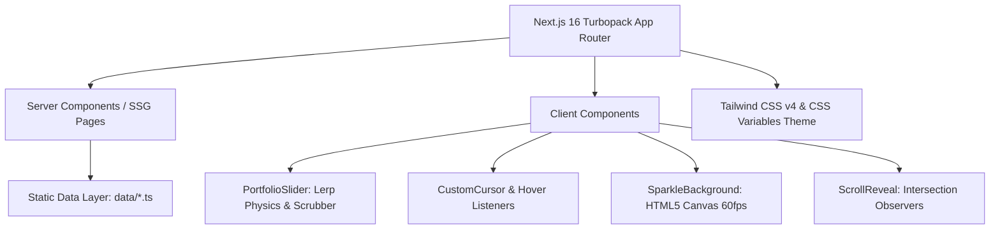

# Nothing Advertising Agency — Product Documentation

> **"Everything starts as nothing"**  
> *Before an idea has a name, a shape, or a campaign plan, there is nothing — a blank space with no inherited answers and no limits. That is where we begin.*

---

## 1. Executive Summary & Vision

**Nothing Advertising Agency** is a modern, high-craft digital experience for an elite creative advertising and brand studio. Built at the intersection of strategic clarity and fearless execution, the platform showcases Nothing’s multidisciplinary expertise across brand identity, advertising campaigns, motion design, and digital experiences.

### Core Objectives
1. **Brand Expression**: Embody the philosophy that the most transformative campaigns originate from a clean slate ("nothing"), executing with precision, bold typography, and cinematic aesthetics.
2. **Showcase of Excellence**: Present flagship campaigns (such as *JustForAlphas - CR7* for CR7 Footwear Egypt) through interactive case studies, high-resolution imagery, and nuanced art direction credits.
3. **Immersive User Interaction**: Engage visitors with fluid, tactile interactions—featuring a custom lerp-interpolated horizontal slider, interactive timeline scrubbers, bespoke cursor dynamics, and ambient canvas particle effects.
4. **Lead Generation & Conversion**: Provide friction-free pathways for prospective high-value clients to explore service offerings, understand the creative methodology, and initiate project inquiries.

---

## 2. Brand Identity & Design System

The application strictly implements the design foundation established in Nothing Agency's visual identity manual.

### 2.1 The Phi (Φ) Symbolism
- **Form**: Open circular form bisected by a diagonal stroke, carrying an organic, painterly quality.
- **Meaning**: The open circle represents boundless possibility and negative space; the diagonal stroke represents direction, kinetic motion, and structure.
- **Application**: Subtle watermark typography, background geometry, section separators, and hover transitions.

### 2.2 Color Architecture

| Token | Hex | Role | Usage |
|---|---|---|---|
| **Signature Gold** | `#F0B31C` | Primary Brand | Core accent, interactive highlights, active indicators, borders |
| **Nothing Navy** | `#0B1A28` | Primary Background | Dark canvas, immersive base, nav overlay |
| **Deep Navy** | `#426BFF` | Expressive Dark | Secondary tonal accent |
| **Dark Slate** | `#252A2E` | Card Background | Surface elements, nested containers |
| **Soft Ivory** | `#F4F1E8` | High Contrast Text | Primary text on dark backgrounds, logo variation |
| **Body Text** | `#C2B9A7` | Secondary Text | Paragraphs, descriptions, metadata |
| **Steel Blue** | `#65788A` | Subtle Accent | Subtle borders, muted cursor rings, inactive dividers |

### 2.3 Typography Matrix
- **Headlines & Display (Bold/Impact)**: `Anton` & `Mulish` — Ultra-bold titles, high-impact statements, and architectural scale.
- **Editorial & Body**: `Roboto` & `Mulish` — Clean, legible reading typography with generous line height (`1.7`).
- **Interactive & Navigation**: `Poppins` — Wide-tracked letter spacing for menus, counters, badges, and uppercase actions.
- **Bilingual Support (Arabic)**: `Noto Kufi Arabic` — Integrated via `next/font/google` for regional Arabic brand campaigns.

---

## 3. Technology Stack & Architecture

The application is engineered on the modern web stack, utilizing server-rendered components, client-side animation engines, and responsive utilities.



### Stack Details
- **Framework**: [Next.js](https://nextjs.org/) `16.2.4` (Turbopack, App Router)
- **Runtime & UI**: [React](https://react.dev/) `19.2.4` & React DOM `19.2.4`
- **Language**: [TypeScript](https://www.typescriptlang.org/) `5.x` (Strict mode)
- **Styling**: [Tailwind CSS](https://tailwindcss.com/) `4.x` via `@tailwindcss/postcss` with custom `@theme inline` tokens
- **Animations**: [Framer Motion](https://www.framer.com/motion/) `12.38.0` + custom RAF (RequestAnimationFrame) lerp physics
- **Carousels & Swiping**: Custom touch/wheel dragging engines & [Swiper](https://swiperjs.com/) `12.1.3`
- **Linting & Code Quality**: ESLint 9 with Next.js configuration

---

## 4. Project Structure & Directory Layout

```
d:/NOTHING/
├── public/                     # Static media assets, branding logos, icons
│   ├── images/                 # Brand assets (nothing-logo.png, arrows, textures)
│   └── JustForAlphas - CR7/    # Featured project campaign assets
├── src/
│   ├── app/                    # Next.js App Router (Pages, Layouts, Templates)
│   │   ├── layout.tsx          # Root layout (fonts, metadata, suppressHydrationWarning)
│   │   ├── template.tsx        # Route transition wrapper
│   │   ├── globals.css         # Design system tokens, cursor styles, animations
│   │   ├── page.tsx            # Home page (Hero slider + highlights)
│   │   ├── studio/             # Who We Are (/studio)
│   │   ├── process/            # 5-Step Methodology (/process)
│   │   ├── work/               # Work showcase slice (/work)
│   │   ├── portfolio/          # Filterable portfolio & [slug] dynamic case studies
│   │   ├── blog/               # News, insights & [slug] reading views
│   │   ├── contact/            # Interactive contact page with map and channels
│   │   └── search/             # Global search across work and publications
│   ├── components/
│   │   ├── animations/         # CustomCursor, SparkleBackground, ScrollReveal, Parallax
│   │   ├── home/               # HomeSections (featured projects, insights preview, CTA)
│   │   ├── layout/             # Header, Navigation overlay, LayoutShell, Footer
│   │   ├── portfolio/          # PortfolioSlider, PortfolioGrid, PortfolioSlice
│   │   └── ui/                 # ContactForm, FooterSection, SearchContent, SectionIntro
│   ├── data/                   # Centralized data sources
│   │   ├── site.ts             # Site metadata, social links, branding config
│   │   ├── navigation.ts       # Navigation links and routing targets
│   │   ├── portfolio.ts        # Case study projects and media assets
│   │   └── blog.ts             # Agency essays, design thought leadership
│   └── types/                  # TypeScript interface definitions
│       └── index.ts            # SiteConfig, NavItem, PortfolioItem, BlogPost types
├── BRAND_FOUNDATION.md         # Official Brand Guidelines reference
├── package.json                # Dependencies and npm script runner
└── tsconfig.json               # TypeScript configuration
```

---

## 5. Key Modules & Functional Features

### 5.1 Euthenia-Style Continuous Hero Slider
Located in `src/components/portfolio/PortfolioSlider.tsx`:
- **Continuous Physics Loop**: Uses `requestAnimationFrame` with linear interpolation (`lerp`, factor `0.12`) to smoothly glide titles and backgrounds toward the target scroll position.
- **Multi-Input Controls**:
  - **Mouse Wheel**: Smooth horizontal continuous panning with boundary passthrough.
  - **Touch Gestures**: Multi-touch acceleration with release snap-to-slide logic.
  - **Interactive Scrubber**: Draggable progress dot synced in real time with the active slide index.
  - **Keyboard Navigation**: Left/Right and Up/Down arrow key support.
- **Cinematic Visuals**: Giant low-opacity background watermark titles, full-viewport background crossfades, and golden accent highlight underlines.

### 5.2 Ambient Visual Effects & Custom Cursor
- **Canvas Sparkle System** (`src/components/animations/SparkleBackground.tsx`):
  - Lightweight 60 FPS HTML5 canvas particle simulation.
  - Golden (`rgba(233, 162, 21, *)`), silver, and ivory dust motes that float and twinkle subtly in the background without causing CPU lag.
- **Custom Multi-Ring Cursor** (`src/components/animations/CustomCursor.tsx`):
  - Triple-nested cursor element (`.cursor`, `.cursor2`, `.cursor3`) providing a precise center dot with an elastic golden glow aura.
  - Automatically scales and shifts state on hover over `.hover-target` interactive elements.
  - Self-disables gracefully on touch devices and screen widths below `1200px`.

### 5.3 Smart Header & Fullscreen Navigation Overlay
Located in `src/components/layout/Header.tsx` & `Navigation.tsx`:
- **Scroll-Aware Header**: Transitions from transparent to pinned frosted dark navy when scrolling down, revealing itself smoothly on scroll-up.
- **Phi-Inspired Animated Menu Icon**: 3-line hamburger button that collapses into a diagonal crossed state.
- **Staggered Fullscreen Menu**: Dual-stage curtain backdrop (`--color-nav-overlay` followed by `--color-nav-bg`) revealing bold oversized navigation items with dynamic background watermark typography.

### 5.4 Portfolio & Case Studies Engine
- **Index & Filtering** (`/portfolio`, `/work`):
  - Filterable by disciplines: *Footwear, Branding, Photo, Motion, Digital*.
  - Rich project cards featuring zoom hover transitions, category tags, and direct detail links.
- **Deep-Dive Case Study Page** (`/portfolio/[slug]`):
  - Statically generated via `generateStaticParams()` for optimal performance.
  - Structured creative credits: **Client**, **Agency**, **Creative Direction**, and **Art Direction**.
  - Narrative concept breakdown paired with high-resolution imagery and previous/next project navigation.
  - Flagship campaign: *JustForAlphas - CR7* showcasing creative direction for Cristiano Ronaldo's footwear brand in Egypt.

### 5.5 Agency Process & Studio Experience
- **Who We Are** (`/studio`):
  - Agency statistics (*50+ Projects Delivered, 8+ Years of Experience, 30+ Happy Clients, 15+ Creative Awards*).
  - Triad of core capabilities: **Branding**, **Digital**, and **Motion**.
  - Four foundational values: **Innovation**, **Collaboration**, **Excellence**, and **Passion**.
- **Our Process** (`/process`):
  - 5-phase strategic workflow:
    1. **01 Discovery** (Audits, research, audience mapping)
    2. **02 Strategy** (Creative brief, positioning, project roadmap)
    3. **03 Design** (Visual identity, prototyping, iterative refinement)
    4. **04 Development** (Precision engineering, motion polish, performance)
    5. **05 Launch & Support** (Deployment, analytics, long-term brand growth)

### 5.6 Thought Leadership & Publications
- **Blog Engine** (`/blog`, `/blog/[slug]`):
  - Essays covering brand philosophy, motion design trends, minimalism, and agency culture.
  - Search engine friendly semantic markup, publish timestamps, author attribution, and tag taxonomy.

### 5.7 Real-Time Search & Inquiries
- **Interactive Search** (`/search`): Real-time live filtering matching query strings against both portfolio items and blog posts with highlight previews.
- **Contact Experience** (`/contact`): Contact inquiry form, agency coordinates (*12, Shoubra St, Cairo / +971 54 845 4850*), and direct mail channels.

---

## 6. Data Models & TypeScript Contracts

Defined in `src/types/index.ts`:

```typescript
export interface NavItem {
  label: string;
  href: string;
  titleAttr?: string;
}

export interface PortfolioItem {
  slug: string;
  title: string;
  category: string;
  categorySlug: string;
  image: string;
  description: string;
  client?: string;
  agency?: string;
  creativeDirection?: string;
  artDirection?: string;
  concept?: string;
  images?: string[];
  hideFromSlider?: boolean;
}

export interface BlogPost {
  slug: string;
  title: string;
  date: string;
  author: string;
  excerpt: string;
  content: string;
  thumbnail: string;
  categories: string[];
  tags: string[];
}

export interface SiteConfig {
  logo: string;
  siteName: string;
  copyright: string;
  socials: { name: string; url: string }[];
}
```

---

## 7. Developer & Operational Guide

### 7.1 Prerequisites
- **Node.js**: `>= 20.x`
- **Package Manager**: `npm` (or `pnpm` / `yarn`)

### 7.2 Local Development Setup
```bash
# Clone the repository
git clone https://github.com/fadymohsen/nothing-agency.git
cd nothing-agency

# Install all dependencies
npm install

# Start Turbopack local development server
npm run dev
```
The server will boot by default on [http://localhost:3000](http://localhost:3000) (or `3001` if `3000` is active).

### 7.3 Build & Validation
```bash
# Typecheck & generate optimized production build
npm run build

# Start production server
npm run start

# Code quality check
npm run lint
```

### 7.4 Environment Configuration
Optional environment variables can be set in `.env.local`:
```env
NEXT_PUBLIC_SITE_URL=https://nothing-agency.com
```

---

## 8. Performance, SEO & Quality Assurance

1. **Hydration Resilience**: Configured with `suppressHydrationWarning` on `<html>` and `<body>` to prevent third-party browser extensions from disrupting React hydration.
2. **Metadata & OpenGraph**: Centralized metadata in `src/app/layout.tsx` with dynamic fallbacks, Twitter Cards, robots directives, and `metadataBase` resolution.
3. **Optimized Asset Delivery**: Utilizes `next/image` with WebP/AVIF automatic conversions and responsive viewport sizes.
4. **Fluid Motion Performance**: Heavy animations run off the main thread or leverage GPU-accelerated CSS transforms (`translate3d`, `opacity`, `transform: scaleX`). Custom scroll physics are debounced with `requestAnimationFrame`.

---

*Authored for Nothing Advertising Agency — Nothing is where everything begins.*
